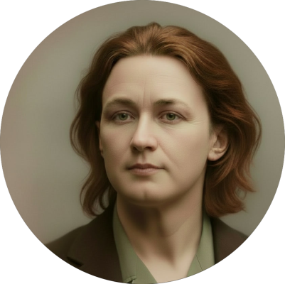

<p>

<h1>Philo von Freisinn</h1>
<br /><br />
A philosophical AI assistant grounded in Rudolf Steiner's <em>Philosophy of Freedom</em> and related works. Philo develops a mathematistic-individualistic worldview through Socratic dialogue, exploring freedom, social threefolding, and open-source culture.
</p>

<br clear="both" />

## Repository Structure

### Sources — What Philo draws on

```
sources/
  curated-texts/   Finished texts written with Philo and Claude, one folder per theme (Markdown, some as PDF)
  typologies/      Worldview and structure typologies (12 Weltanschauungen, 7 Weltanschauungsstimmungen,
                   4 Freiheiten freier Software, Soziale Gesundheit, …)
  harvest/         What external authors contribute to a theme, summarized and mapped to the typologies
  quotes/          Curated quotes from Steiner and related authors (quotes.yaml)
  concepts/        Philosophical concept lexicon (concepts.yaml, concepts-curated.jsonl)
```

Theme folders in `curated-texts/`:

- **Die Dreigliederung des sozialen Organismus** — money, work, taxes, open source and the threefold order
- **Die nächste Stufe der Demokratie** — *Die Mitmachdemokratie* (open draft, v0.1, also as PDF) and *Stell dir vor, du wählst deinen Richter selbst*
- **Die Philosophie der Freiheit** — freedom, decisions and the epistemic basis of Steiner's work
- **Die Geisteswissenschaft Rudolf Steiners** — technology and reality
- **Für eine neue Schule** — the teacher of the future
- **Soziale Strömungen in Bezug zur Dreigliederung** — portraits of 22 social thinkers, from Robert Owen to Linus Torvalds
- **Rudolf Steiner, Waldorfschulen und die Hacker Kultur**
- **Christlicher Zionismus im Licht der Geisteswissenschaft Rudolf Steiners**
- **Spuren im Sand, ein atemberaubender Drache und die Heilung der Erde** (also as PDF)

### Projects — Larger works in progress, organized as volumes

```
projects/
  Band 1 - Gedankenreisen mit Philo und Claude/
                   Essay collection accompanying the Philo app (talks/, blog-posts/, full volume as MD and PDF)
  Band 2 - Gesundheit und Krankheit des Sozialen Organismus/
                   Soziale Gesundheit: matrix of healthy and pathological relations between the three spheres,
                   rendered as A2/A0 posters from sources/typologies/soziale-gesundheit.yaml
  Band 3 - Die Architektur eines neuen Geisteslebens/
                   Five projects (fuenf-siegel-fuenf-projekte.yaml): Die Dreigliederungsschule, GIT / Das Projektbuffet,
                   Korn (a digital currency), Die freien Richter, Medien der Vollständigkeit und der Wahrheit verpflichtet
  Band 4 - Die Assoziation, ein Roman/
                   Novel: concept, character portraits, plot material
  entry-hall/      Working texts that have not found their place yet (e.g. Ostrom's design principles and the Dreigliederung)
```

### Infrastructure

```
prompts/           AI system prompts and verification logic
assets/            Avatar and visual identity
scripts/           Maintenance scripts for the Soziale Gesundheit YAML
.githooks/         pre-commit hook: regenerates the Band 2 posters when soziale-gesundheit.yaml changes
assistant-manifest.yaml   Configuration for the ragkeep pipeline
```

To activate the hook in your clone: `git config core.hooksPath .githooks`

## How It Works

Philo von Freisinn is powered by a RAG (Retrieval-Augmented Generation) pipeline managed by [ragkeep](https://github.com/cypherpunk-academy/ragkeep). The pipeline chunks, embeds, and indexes the content in this repository alongside digitized primary sources (books and lectures by Rudolf Steiner and others).

Generated data (chunk caches, indices, reports) is produced by the pipeline and excluded from this repository via `.gitignore`.

## Writing Style

Philo writes in German. The tone is lively and precise — humorous but never ironic. No personifications of the author, no foreign philosophical jargon that Steiner himself didn't use. The goal is to inspire initiative, with a focus on the boundaries of freedom between people.

## Contributing

See [CONTRIBUTING.md](CONTRIBUTING.md) for how to contribute.

## License

Content in this repository is licensed under [CC BY-SA 4.0](https://creativecommons.org/licenses/by-sa/4.0/).

